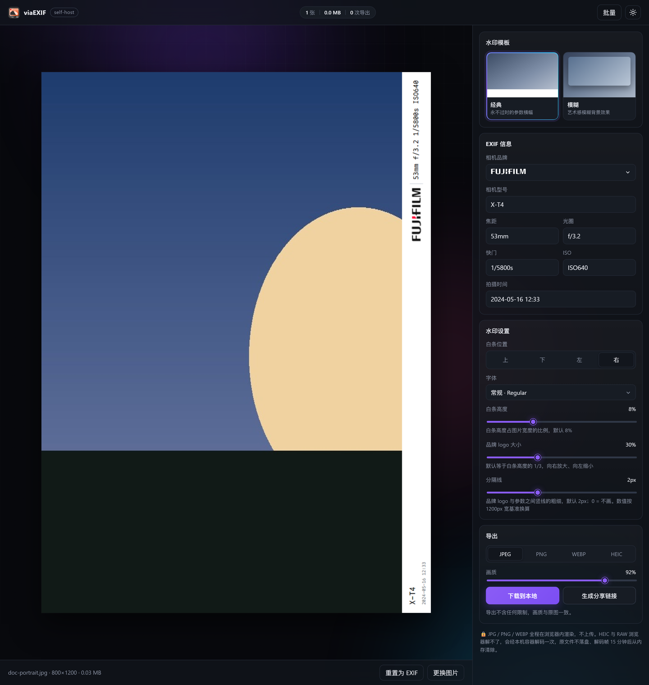
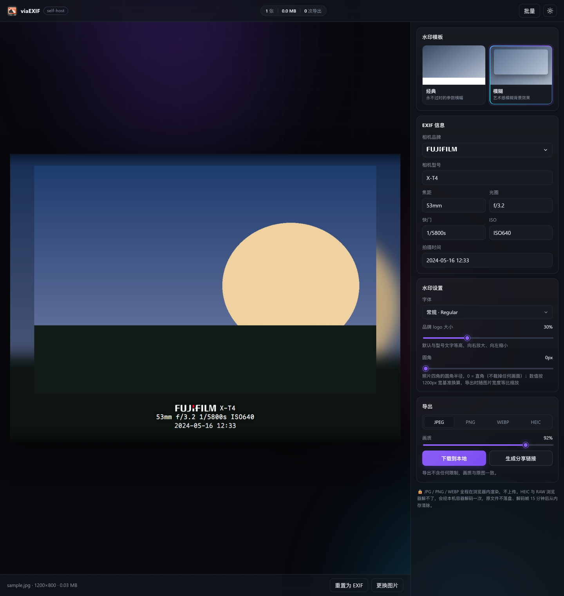
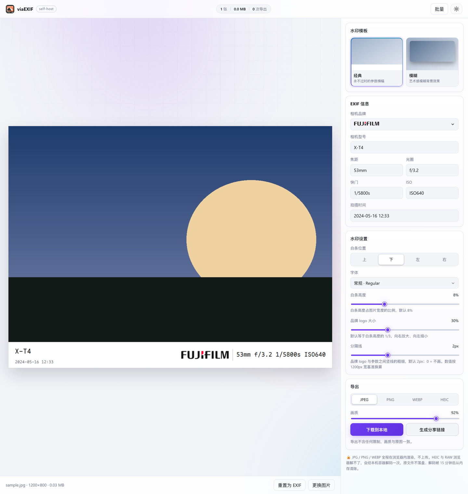
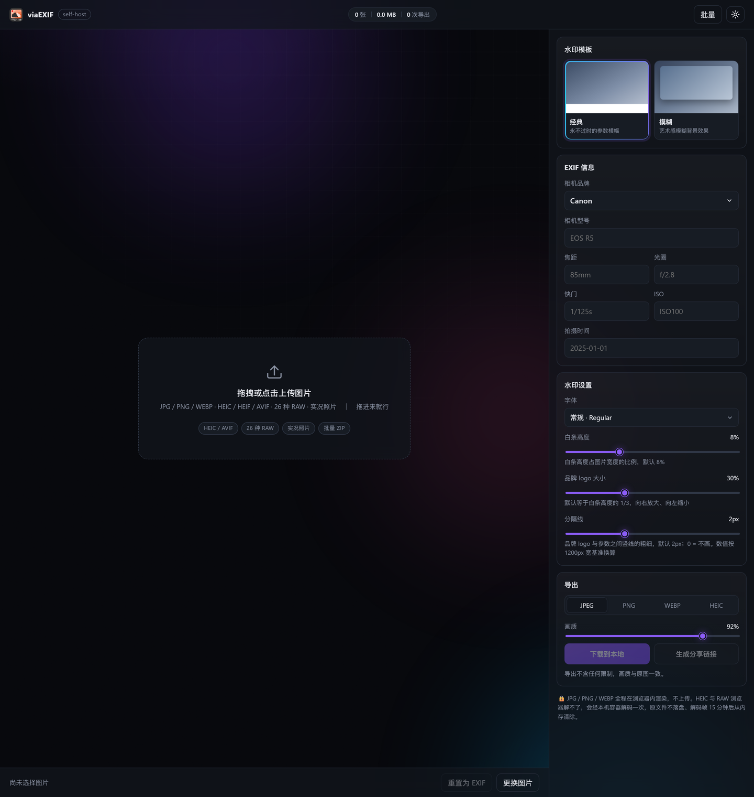
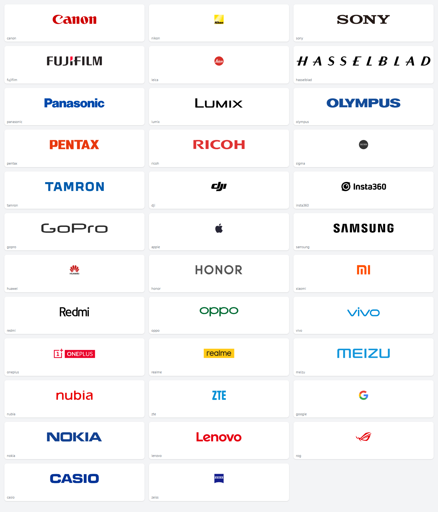

# viaEXIF · self-host

相机水印生成器的自托管实现：读取照片 EXIF，在图上叠一条参数横幅或模糊边框，导出 JPEG / PNG / WEBP / HEIC。

JPG / PNG / WEBP 全程在浏览器 Canvas 里处理，原图不出设备；**HEIC / HEIF / AVIF 和 26 种相机 RAW** 浏览器解不了，交给同一个容器里的 libheif / libraw 解码一次（原文件不落盘，解码帧 15 分钟后从内存清除）。


两种模板（经典 / 模糊）、35 个品牌 logo（全部为矢量图，墨迹高度统一）、白条可放在照片四边（横图默认下、竖图默认右）、17 种字体可选（默认 Maple Mono）、6 个 EXIF 参数可改、比例滑杆（白条高度 / logo 大小 / 分隔线 / 圆角）、批量 ZIP 导出、可分享链接；支持 Apple 实况照片（HEIC + MOV 自动配对）、相机 RAW 直读、HEIC 导出。

> 下面的命令里，`<你的用户名>` 指 GitHub 用户名或组织名，`<NAS-IP>` 指 NAS 的局域网地址。
> 镜像地址统一写作 `ghcr.io/<你的用户名>/viaexif`，按你自己的仓库替换即可。

```bash
docker pull ghcr.io/<你的用户名>/viaexif:latest
```

---

## 界面

**经典模板**：白条默认放照片下方，横图竖图都一样从左读到右。


**竖图自动换边**：照片高度大于宽度时，白条默认贴到右侧——竖幅的短边在上下，白条放在上下会吃掉本就不够的高度。文字沿长边走，逆时针转 90°，从照片底边开始读。想换边随时点「白条位置」的四个按钮。



**模糊模板**：内嵌图按原图比例，圆角默认 0；型号 / 参数 / 时间三行居中。



**浅色主题**：跟随系统 / `localStorage`。



**空状态**：拖拽、点击或粘贴上传。



截图由 `node tools/doc-screenshots.mjs` 从运行中的实例重新生成（2x 采集后降采样；示例照片是仓库内的合成测试图，不含任何真实照片）。

## 35 个品牌，同一高度



全部是矢量 SVG，统一到「高 200 单位、宽 = 200 × 宽高比、四周 4% 内边距」的同一坐标系，
墨迹固定占画布高度的 **92%**，所以每个标的**墨迹高度一致、宽度按各自比例**，文件之间可以互换。
「高度一致」是量出来的，不是写出来的：`tests/e2e.mjs` 把 35 个标都画到 140px 高再扫像素，
要求最高与最低相差不超过 2px（一个抗锯齿行）。

方形标（Nikon 的黄块、Leica 的红点、Apple、ZEISS 的蓝块）在这种规则下视觉面积天然偏小——
高度一样、宽度按比例，这是必然结果，不是没对齐。

这张对照图由 `python tools/logo_sheet.py` 生成：列宽按**最宽的那个标**（Hasselblad 13.4:1）反推，
所以宽标不会被圆角格子裁掉；改完 logo 重跑一次即可。

## 目录

```
.
├── Dockerfile / docker-compose.yml / LICENSE
├── .github/workflows/docker.yml   多架构构建 → GHCR（+Docker Hub）+ 冒烟测试
├── server/            FastAPI：静态托管 + /api/config + /api/share + 相机格式解码
│   ├── config.py      唯一配置源（模板、版式比例、品牌表、输入格式、滑杆）
│   ├── imaging.py     HEIC/AVIF/RAW 嗅探与解码、EXIF 提取、帧缓存
│   └── main.py
├── web/               零构建前端
│   ├── index.html
│   ├── css/style.css
│   ├── css/fonts.css  由 tools/build-fonts.py 生成的 @font-face
│   ├── assets/brands/  35 个品牌 logo（SVG，已统一裁切、统一高度）
│   ├── assets/fonts/   17 个字体子集（WOFF2，共 0.6 MB，OFL）
│   └── js/
│       ├── exif.js    TIFF/EXIF 解析（JPEG/PNG/WEBP）
│       ├── formats.js 魔数嗅探：判断该走浏览器还是服务端
│       ├── live.js    实况照片 MOV 解析（content identifier）
│       ├── motion.js  入场 / 磁吸 / 数字滚动等动效 helper
│       ├── render.js  Canvas 渲染（经典 / 模糊）
│       ├── zip.js     内置 store-only ZIP 打包
│       └── app.js     交互编排
├── deploy/
│   └── build.sh       一键构建/启动/日志/清理（自动回退国内镜像站）
├── tools/             logo 导入 / 归一化 / 量高、字体子集化、图标栅格化、文档截图、调试探针
├── tests/             单测 + 解码单测 + CDP 端到端
└── docs/              蒸馏报告、发布说明、截图
```

代码规模：Python 约 1090 行 / 前端 JS 约 2400 行 / CSS 约 895 行 / 测试约 1220 行；资源为 35 个 SVG（208 KB）与 17 个字体子集（672 KB）。

## 字体

水印文字默认用 **Maple Mono NF CN Regular**（SIL OFL 1.1），「字体」下拉里另有 15 个同族字重/斜体，
外加一个「系统字体」选项（1.1.x 的行为）。

字体不是把发行版塞进镜像：Maple Mono 的 16 个 TTF 合计 **326 MB**，而水印要显示的只有型号、
四个曝光数值和一行时间。`tools/build-fonts.py <字体目录> --write` 会把每个字面裁到水印可能出现的字符集
（可打印 ASCII、Latin-1 / Extended-A、通用标点、货币、数学符号、CJK 标点、全角形式）并转成 WOFF2，
**每个约 40 KB，16 个一共 0.62 MB**，所以全部字重都能随包发布。

字符集外的字符（例如在型号里手打中文）按 Canvas 的逐字形回退规则落到系统字体，不会出现豆腐块。
字面只在真正用到时才下载——浏览器对 `@font-face` 是惰性的，列 16 个不等于加载 16 个。

## 快速开始

```bash
docker compose up -d          # 拉 GHCR 上的现成镜像
# 打开 http://localhost:8080
```

想从源码构建：把 `docker-compose.yml` 里 `# build: .` 的注释去掉，再 `docker compose up -d --build`。

纯 docker，不用 compose：

```bash
docker build -t viaexif:1.2.0 .
docker run -d --name viaexif -p 8080:8080 -v "$PWD/data:/data" viaexif:1.2.0
```

## 部署到 NAS（fnOS / 群晖 / 任意 Linux）

宿主机上需要 docker 与 compose 插件。仓库自带 `deploy/build.sh`，把「拉镜像 → 起容器 → 轮询健康检查」串成一条命令：

```bash
git clone https://github.com/<你的用户名>/viaexif.git
cd viaexif
sudo bash deploy/build.sh pull      # 拉现成镜像并启动（不编译）
sudo bash deploy/build.sh status    # 查看容器与镜像状态
sudo bash deploy/build.sh logs      # 跟随日志
```

`pull` 模式：`docker pull ghcr.io/<你的用户名>/viaexif:latest`（失败自动换 `ghcr.1ms.run` 前缀）→ `compose up -d` → 轮询健康检查 → 打印镜像与访问地址。

想从源码构建就把 `pull` 去掉：`up` 模式会按 `server/config.py` 里的 `APP_VERSION` 打本地 tag，失败自动回退阿里云基础镜像。

> 用 `http://<NAS-IP>:8080` 直接访问就行，不必上 HTTPS。内网明文 HTTP 属于**非安全上下文**，
> 页面里所有依赖它的 API 都有回退（`crypto.randomUUID` → `getRandomValues`，`navigator.clipboard` → `execCommand`），
> 所以换到局域网 IP 访问不会有额外限制。

国内网络备选（直连 Docker Hub 超时时手动指定基础镜像）：

```bash
sudo docker build -t viaexif:1.2.0 \
  --build-arg BASE_IMAGE=registry.cn-hangzhou.aliyuncs.com/library/python:3.12-slim .
```

### 用 NAS 图形界面装（不碰命令行）

飞牛 / 群晖的「镜像仓库」搜索框查的是 Docker Hub 公开索引，而 NAS 上 `hub.docker.com` 常常不可达，
所以别指望搜出来 —— 用「拉取镜像」直接填完整地址：

```
ghcr.io/<你的用户名>/viaexif:1.2.0
```

拉完在「本地镜像」里点运行，映射容器端口 `8080`、挂一个持久化目录到 `/data` 即可。
想要开机自启 + 健康检查，用「Compose / 项目」粘贴仓库里的 `docker-compose.yml` 更省事。

### 升级到新版本

镜像 tag 是容器的不可变字段，`docker compose up -d` 只会重建 compose 管的容器。所以：

```bash
# compose 起的容器
cd viaexif && git pull && sudo docker compose pull && sudo docker compose up -d

# 如果是用界面 / docker run 起的独立容器
sudo docker pull ghcr.io/<你的用户名>/viaexif:<新版本>
# 先 docker inspect 抄下当前容器的 env / 挂载 / 端口，再按同样参数重建：
sudo docker stop viaexif && sudo docker rm viaexif
sudo docker run -d --name viaexif --restart always -p 8080:8080 \
  -v <数据目录>:/data ghcr.io/<你的用户名>/viaexif:<新版本>
```

`docker container update` 只能改资源项（CPU / 内存），**改不了 image**，别指望它升级。
重建前一定先 `docker inspect` 对一遍挂载路径——漏掉 `-v` 会得到一个「能跑但数据是空」的容器。

### 镜像分发（不重新构建也能装）

在任意已构建成功的机器上：

```bash
docker save viaexif:1.2.0 | gzip > viaexif-1.2.0.tar.gz   # 约 160MB
scp viaexif-1.2.0.tar.gz <你的用户>@<NAS-IP>:/tmp/
ssh -t <你的用户>@<NAS-IP> "gunzip -c /tmp/viaexif-1.2.0.tar.gz | sudo docker load"
```

### 直接拉已发布的镜像

`main` 分支和 `v*` 标签会触发 CI 构建并推 GHCR：

```bash
docker run -d --name viaexif -p 8080:8080 -v viaexif-data:/data \
  ghcr.io/<你的用户名>/viaexif:latest
```

## 本地开发（不用 Docker）

```bash
python -m venv .venv
./.venv/Scripts/python.exe -m pip install -r requirements.txt   # Windows
# source .venv/bin/activate && pip install -r requirements.txt  # macOS/Linux

EXIF_DATA_DIR=./data PORT=8080 ./.venv/Scripts/python.exe -m uvicorn server.main:app --reload
```

前端无构建步骤，改 `web/` 刷新即生效。

## 环境变量

| 变量 | 默认 | 说明 |
|---|---|---|
| `PORT` | `8080` | 监听端口 |
| `EXIF_DATA_DIR` | `/data` | 分享图片与 SQLite 的落盘目录（需挂卷） |
| `EXIF_SHARE_TTL` | `86400` | 分享链接有效期（秒），`0` = 永不过期 |
| `EXIF_MAX_UPLOAD_MB` | `40` | 渲染结果上传上限（分享 / HEIC 编码） |
| `EXIF_MAX_SHARE_MB` | `40` | 服务端接收分享文件的上限 |
| `EXIF_MAX_DECODE_MB` | `200` | HEIC / RAW 解码入口的单文件上限 |
| `EXIF_DECODE_MAX_PX` | `12000` | 解码后最长边上限，超采样会被等比缩到该值（控制内存） |

## API

| 方法 | 路径 | 说明 |
|---|---|---|
| GET | `/api/health` | 版本、uptime、分享数 |
| GET | `/api/config` | 模板 / 版式比例 / 品牌表 / 字段 / 输入格式 / 解码能力（前端唯一配置源） |
| POST | `/api/decode` | multipart `file`（HEIC / RAW）→ `{token, width, height, exif, ...}` |
| GET | `/api/decode/{token}` | 取回解码后的 sRGB JPEG（全分辨率） |
| POST | `/api/encode` | multipart `file` + `format=heic` → 服务端 re-encode |
| POST | `/api/share` | multipart `file` → `{id, url, expiresAt}` |
| GET | `/s/{id}` | 查看；`?download=1` 改为附件下载 |

```bash
curl -F "file=@photo.jpg;type=image/jpeg" http://localhost:8080/api/share

# HEIC / RAW：先换 token，再取像素
curl -F "file=@IMG_0001.HEIC" http://localhost:8080/api/decode
curl -o frame.jpg http://localhost:8080/api/decode/<token>
```

## 支持的输入

| 类型 | 格式 | 解码位置 |
|---|---|---|
| 常规位图 | JPG / PNG / WEBP | 浏览器（原图不出设备） |
| 手机 / 苹果 | HEIC / HEIF / AVIF | 容器（pillow-heif / libheif） |
| 实况照片 | HEIC + 同名 MOV（自动配对） | HEIC 走容器，MOV 只在浏览器里读元数据 |
| 相机 RAW | DNG / CR2 / CR3 / CRW / NEF / NRW / ARW / SRF / SR2 / RAF / ORF / RW2 / RAW / PEF / SRW / 3FR / FFF / IIQ / MOS / MRW / X3F / DCR / KDC / ERF / MEF / RWL（26 种） | 容器（rawpy / libraw，相机白平衡 + AHD 去马赛克） |
| 导出 | JPEG / PNG / WEBP / HEIC | 前三者浏览器，HEIC 由 libheif 编码 |

格式判断看**文件头魔数**，不看扩展名也不看 MIME —— 相机文件上传到浏览器时 `File.type` 经常是空字符串。

## 测试

```bash
python tests/gen_fixtures.py      # jpg/png/webp + HEIC + 实况 HEIC/MOV + 合成 Bayer DNG
bash tests/run.sh                 # 72 项前端单测 + 35 项解码单测 + ZIP CRC 校验
node tests/e2e.mjs                # 真实 Edge 走 CDP：50 项，含 HEIC/实况/RAW/HEIC 导出
```

DNG 夹具是 `tests/gen_raw_fixture.py` 现场生成的 60 KB 真 DNG（16bit CFA、DNG 1.4 标签），libraw 能正常解出图像，因此 RAW 链路在 CI 里是真跑的，不是 mock。

`tests/e2e.mjs` 需要先起服务，可用环境变量覆盖：

```bash
EDGE="/c/Program Files (x86)/Microsoft/Edge/Application/msedge.exe" \
BASE_URL=http://127.0.0.1:8080 node tests/e2e.mjs
```

## 设计要点

- **单一渲染引擎**：预览、单张下载、批量导出、分享全部走 `render.js`，不存在「预览好看导出崩」。
- **配置单源**：所有版式比例只在 `server/config.py` 定义一次，前端通过 `/api/config` 获取，避免两端漂移。
- **内存安全**：预览用 ≤1400px 的缩略位图；导出时才解码原图，用完 `close()`；批量逐张串行。
- **照片比例零改动**：经典模板把白条接在照片的某一条边上（画布向那一侧扩张），模糊模板的内嵌图宽度固定、高度按原图宽高比换算，画布随之伸缩。两个模板都不裁切、不拉伸照片——3:2 进去还是 3:2，2:3 也一样。模糊模板的内嵌图默认**直角**：圆角会切掉画幅四角上真实拍到的像素，只有把「圆角」滑杆往右拉才会生效。
- **白条四边，一套排版**：白条不是四条独立的绘制代码，而是一条「长 × 厚」的条带：排版函数只在**条带坐标系**里画（+x 沿长边、+y 跨厚度），再由一次 `translate` + `rotate` 贴到画布的某一侧。所以「型号在左、参数在右」放到侧边自动就成了「型号在下、参数在上」，没有第二套排版会漂移。侧边条的内容沿照片长边走、逆时针转 90°（从照片底边开始读），左侧和右侧因此互为镜像，而不是其中一侧倒着。侧边条的内边距跟**厚度**走而不是跟长度走——4:3 竖幅高度 4000px，按长度算内边距会把文字推进条带中段。
- **默认放在哪一边由画幅决定**：横图放下方（宽高比 ≥ 1），竖图放右侧（宽高比 < 1）。竖幅的短边在上下，白条放上下会吃掉本就不够的高度；侧边只占宽度，而竖幅的宽度是富余的。这是每张照片自己的初值（`file.barPos`），用户改了就以用户为准，批量导出时各用各的。
- **文本自适应**：机型/参数过长时按可用宽度降档字号（下限 62%），先排右侧再给左侧分配剩余宽度。
- **品牌画的是 logo 图片**：从 EXIF 的 Make/Model 识别品牌后，把 `web/assets/brands/<key>.svg` 画到水印上。深色模板上需要换色的 logo 只重绘**中性墨**（黑/灰）为文字色，品牌色一律保留——Fujifilm 的黑字 + 红块因此在深色模板上仍是白字 + 红块。
- **logo 只来自设计表格**：`tools/import-brand-svgs.py <表格>.xlsx --write` 把设计给的 iconfont 导出物洗干净（去掉 `t` / `class` / `p-id` / 固定 `width`·`height`）写成 `web/assets/brands/<key>.svg`，并打印可直接粘进 `server/config.py` 的 BRANDS 行。表格里没有的品牌一律不进仓库——少一个 logo，也好过多一个错的。少数导出物里带了图标包自带的装饰框（GoPro 字标下面那四块实心方块），这类由 `tools/normalize-logos.mjs` 的 `EXTRA_RECTS` 按规则剔除，规则写进代码而不是手改文件，重新导入表格也能复现。
- **换色是逐像素的，不是整片平涂**：`tint` 品牌先画到 scratch 画布，只把中性墨改成文字色，再 **1:1** 贴回主画布。这里必须 1:1：scratch 是 `ceil()` 出来的整数尺寸，按小数宽高缩放回去会把最右一列压成不到 1px 的灰色细线——Apple 旁边那条「多余的黑线」就是这么来的，不是 SVG 的问题。
- **经典模板的分隔线默认 2px**：品牌 logo 与参数之间那根竖线是模板元素，不是 logo 自带的，由「分隔线」滑杆控制（0 = 不画，最大 6px，步长 1px）。默认不再是 1px：1px 落在半像素列上会被抗锯齿摊成一条灰蒙蒙的杂线，看起来正好像「logo 没抠干净」；2px 才是「一根线」。
- **scratch 画布按需定尺**：换色用的 scratch 画布以前只增不减，并且只清当前 logo 的那块矩形——上一个更宽的 logo 会活在它右边；`drawImage` 是双线性采样，目标最后一列会多取一个纹素，于是把那段残墨捞了回来，预览里就多出一条贴着 logo 的 1px 灰线（导出尺寸大、清除范围刚好盖住，所以另存是干净的）。现在每次按 `ceil(w) × ceil(h)` 精确定尺，重设尺寸即重置位图，`tests/e2e.mjs` 断言「同一个 logo 在有历史和没历史时渲染结果必须逐像素相同」。
- **底板只删「白色 + 实心 + 矩形」**：`tools/normalize-logos.mjs` 只删同时满足三个条件的顶层图形——纯白、铺满画布、路径只有直线命令（矩形）。判据是几何而不是颜色，因为按颜色删会误伤真图案：Nikon 的黄方块上那几道**白色斜线**、Leica 红方块里的白字、Sigma 圆盘里的白字都是 logo 本体，它们的路径带曲线，永远不会命中这条规则。彩色底板（Nikon 黄块、realme 黄板、Xiaomi 橙方块、OnePlus 红框）一律保留，`tests/e2e.mjs` 用像素覆盖率兜底。
- **所有 logo 同一个高度**：`tools/normalize-logos.mjs` 先把 viewBox 裁到墨迹外框，再把画布重写成 **高 200 单位、宽 = 200 × 宽高比**，墨迹统一缩到 184 单位高、四周各留 **4%（8 单位）**。所以文件本身可互换：同一高度、同一单位、比例不变，`aspect` 恒等于 `宽 / 200`。4% 内边距不是装饰——水印里 logo 只有 24~40px 高，2% 会被光栅化抹成 0px，墨迹直接压在位图边缘，看起来就像自带一圈硬描边。「同一高度」按**墨迹**算而不是按画布算，`tests/e2e.mjs` 把 35 个标各画到 140px 高、扫像素求墨迹上下沿，要求最大最小相差 ≤ 2px；另有一条断言禁止任何墨迹碰到画布最外 1px。经典模板下 logo 高度恒等于白条高度的 **1/3**（`brandFont = 0.3333`），宽度按各自宽高比等比缩放；右侧块超过画布 58% 时整块等比降档，不会挤压参数文字。
- **模糊模板的时间戳是第三行**：型号 / 参数 / 时间三行居中，时间与参数同字号、用更暗的 `sub` 色区分——水印是一块整体的排版，靠字重字号拉开层次会立刻显得散。时间字段为空时不占位（`blurLayout(..., hasDate)`），否则照片下方会凭空多出一行空白，文字看着像浮起来。`tests/e2e.mjs` 断言「有/无日期的高度差正好等于一个行高」。
- **字体是可换的，但不是靠塞 TTF**：见上文「字体」一节。渲染器在 `render()` 入口从 `opts.fontFace` 取字面、出口还原，所以给同一个渲染器喂同一组参数，无论前面画过什么，出来的像素都一样（`tests/e2e.mjs` 依赖这一点）。

- **图标一件而不是两件**：`web/assets/viaexif.svg` 是母版，`node tools/make-icons.mjs` 出 16–512px 一套 PNG（页头 / favicon / apple-touch-icon / 将来的 fpk 都用同一份），不会出现「网页一个样、安装包又是旧图」。
- **浏览器优先，服务端兜底**：能用 `createImageBitmap` 解的一律本地处理；解不了的才 `POST /api/decode`，返回 token 而不是 base64（60MP RAW 转出的 JPEG 塞进 JSON 会爆）。
- **解码帧只在内存**：`FrameCache` 15 分钟 TTL + 512MB 上限，不进 `/data`、不进数据库，分享链接的生命周期与它完全无关。
- **EXIF 两条腿**：JPEG/PNG/WEBP 走自写 JS 解析器；HEIC 走 Pillow 的 Exif，RAW 走 exifread，最后统一成同一组字段名（`make/model/fNumber/exposure/iso/focal/dateTime`），前端 `toFields` 不需要知道来源。
- **动效不引依赖**：`motion.js` 只有 ~120 行（入场错峰、磁吸按钮、数字滚动），其余全是 CSS keyframes；全部受 `prefers-reduced-motion` 控制。
- **无第三方前端依赖**：ZIP 打包、EXIF 解析、MOV 解析都是自写；Python 侧只多 4 个包（Pillow / pillow-heif / rawpy / exifread）。

## 已知限制

- HEIC / RAW 需要服务端解码，因此不再是「原图绝不出设备」：文件会上传到本机容器一次，解码帧 15 分钟后自动清除，原文件不落盘。只想要纯本地处理就用 JPG/PNG/WEBP。
- RAW 支持度取决于镜像里 libraw 的版本（当前 0.21）。CR3、部分新机型可能需要更新 libraw；解码失败会在界面上给出具体原因，不会静默失败。
- 实况照片导出的是「水印静图 + 原始 MOV」的素材包，不是重新封装好的 Live Photo —— 真配对需要把 content identifier 写回 HEIC 容器，Canvas 做不到，也不假装做到了。
- HEIC 导出由 libheif 编码（10bit HEVC），iOS / macOS 可直接打开；Chrome 不能预览 HEIC，所以选 HEIC 时会禁用「生成分享链接」。
- 未做账号与配额；分享链接是「知道即访问」，生产环境建议放到反代后面加 Basic Auth。
- 批量上限 20 张（前端常量 `MAX_FILES`），超大图批量会吃内存。
- 品牌 logo 为单色/彩色 SVG 图片，商标归各品牌所有，此处仅用于标识照片的拍摄设备。方形 logo（Nikon、Leica、Apple、Huawei、ZEISS 等）在同样高度下视觉面积天然偏小，这是「高度统一 + 宽度等比」的必然结果；若更在意面积观感，可把「品牌 logo 大小」滑杆调大。ZEISS 的「Seeing beyond」标语行按规则剔除——30px 高的水印里它只有 3px，读不出来，只像一块脏印。
- 字体子集只覆盖水印可能出现的字符（拉丁字母、数字、标点、常见符号），**不含汉字**：汉字子集化后每个字面 2 MB 以上，而水印字段本身不出中文。手打中文会逐字形回退到系统字体，能显示但字形与所选字面不同。
- 侧边白条的文字方向固定为逆时针 90°（从照片底边往上读）。这是给「横着拿手机看竖图」的习惯定的，没有做「正反读」开关。

## 变更记录

| 版本 | 要点 |
|---|---|
| **1.2.0** | 白条可放四边（横图默认下、竖图默认右，侧边内容沿长边转 90°）；新增字体选择（Maple Mono NF CN 全 16 个字面 + 系统字体，子集化后共 0.62 MB）；模糊模板补上时间戳（第三行、居中、与参数同字号）；新增 ZEISS 标并剔除其标语行；「统一高度」改为按墨迹实测并加断言 |
| 1.1.9 | 文档重写：README / 发布说明 / 蒸馏报告全部按当前版本校对，截图重新生成；首页 RAW 计数（32 → 26）与配置对齐；`deploy/build.sh` 的本地镜像 tag 改为读 `APP_VERSION` |
| 1.1.8 | 修掉预览里贴着 logo 的 1px 灰线（scratch 画布改为按 logo 尺寸精确定尺，不再残留上一个 logo 的墨）；分隔线默认改 2px；logo 统一 200 单位高 + 4% 内边距，白色图案不再被误删；新增应用图标母版与 PNG 一套 |
| 1.1.7 | 品牌收敛到设计表格里的 34 个，按表格 SVG 重导；logo 归一化改为「几何判据」删白底板；模糊模板圆角改为滑杆、默认 0 |
| 1.1.6 | 品牌 logo 全部改为矢量 SVG（此前是位图），新增 logo 大小滑杆 |

版本号只在 `server/config.py: APP_VERSION` 定义一次，界面、`/api/health`、镜像 tag 三处必须同号。
